

  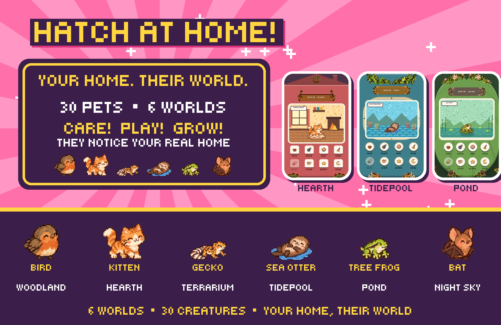

<strong>★ A tiny pixel pal for your big smart home! ★</strong>

  
  
  

---

## 🥚 IT'S HATCHING!

Meet the tiny roommate who lives on your Home Assistant dashboard! It **eats,
naps, plays, gets messy, dreams and grows up**, and it notices what your real
home is doing. It never dies, and your house can never hurt it.

**30 pets • 6 worlds • 3 mini-games • 1 big smart home!**

  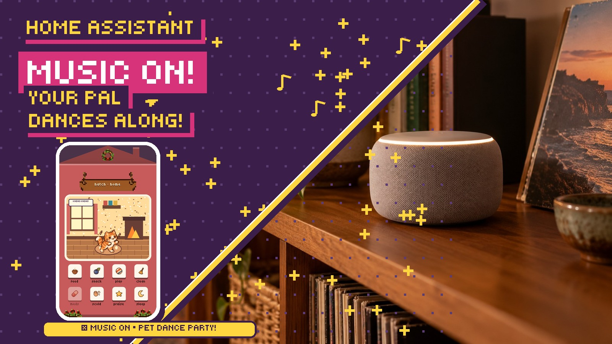

Your home starts the music. Your little roommate joins in.

  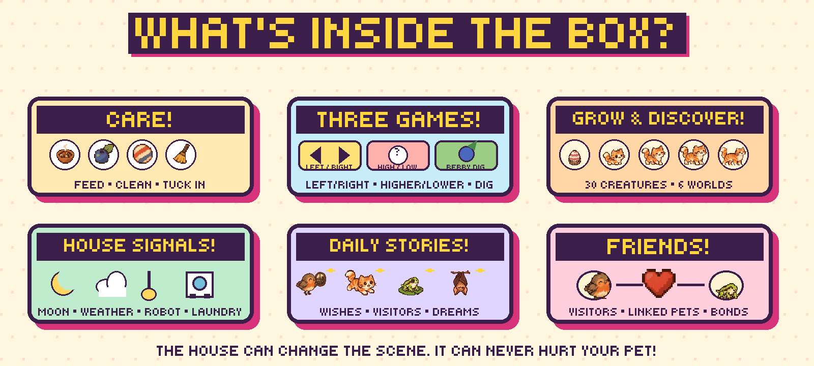

  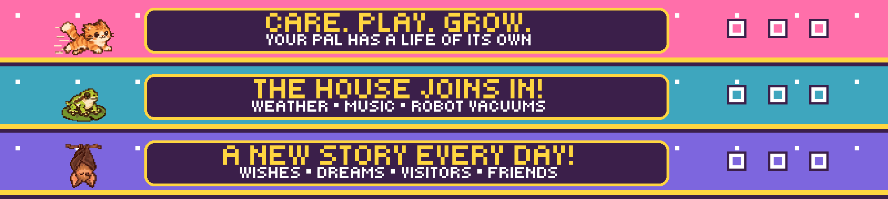

## ★ SIX SHELLS. SIX BOXES. ★

Pick a world and its little device. Each starts with its own first pet.

<table>
<tr>
<td width="33%" align="center">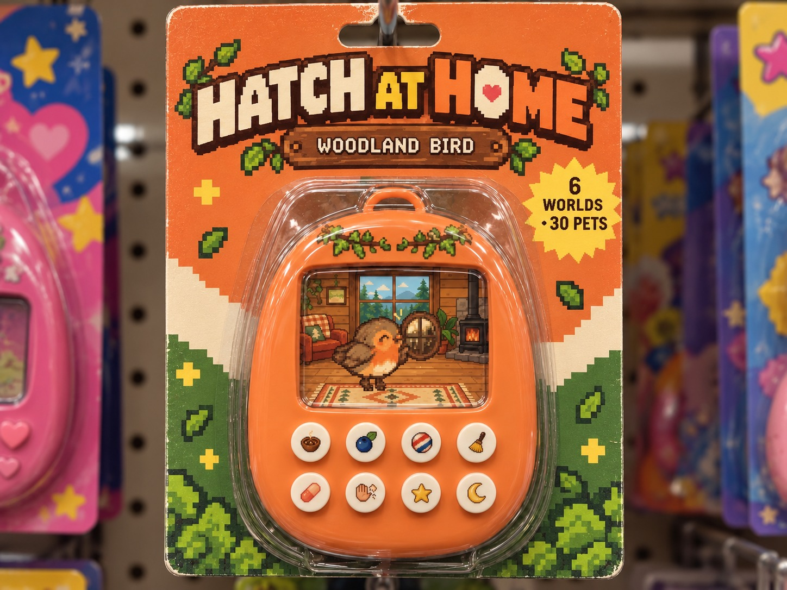 <strong>WOODLAND • BIRD</strong> Color LCD</td>
<td width="33%" align="center">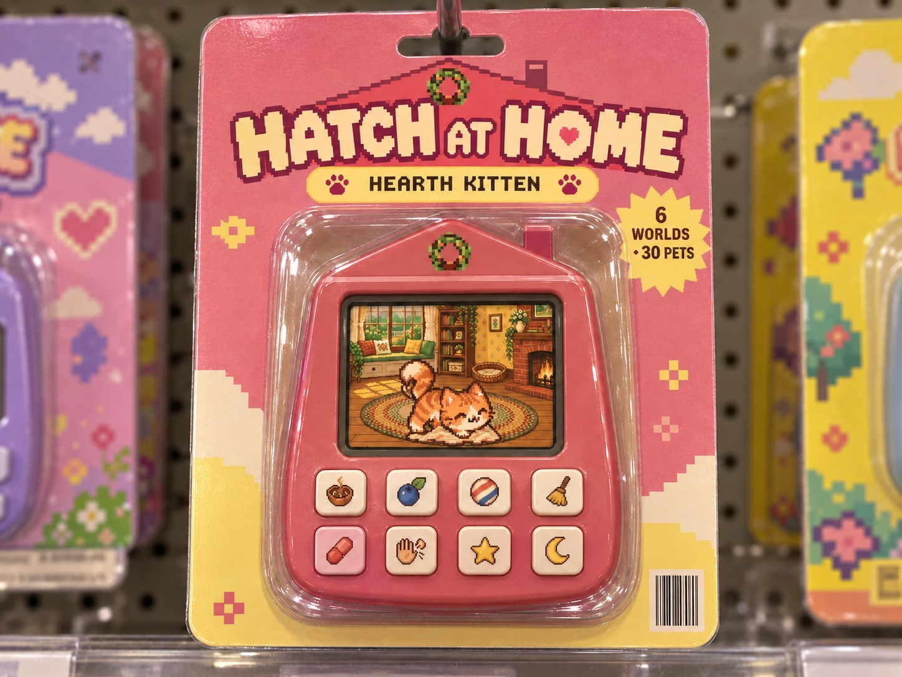 <strong>HEARTH • KITTEN</strong> Color LCD</td>
<td width="33%" align="center">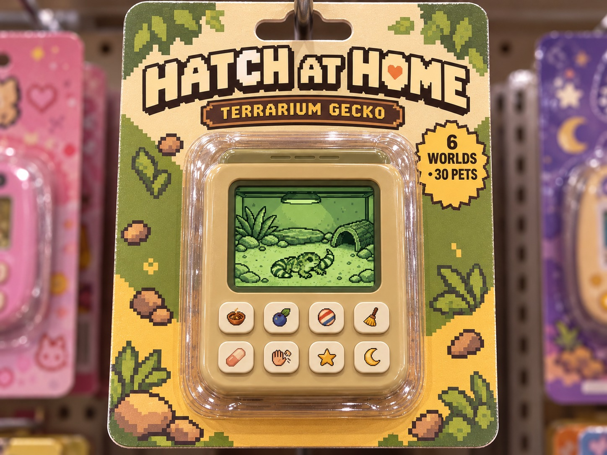 <strong>TERRARIUM • GECKO</strong> Four-green mono</td>
</tr>
<tr>
<td width="33%" align="center">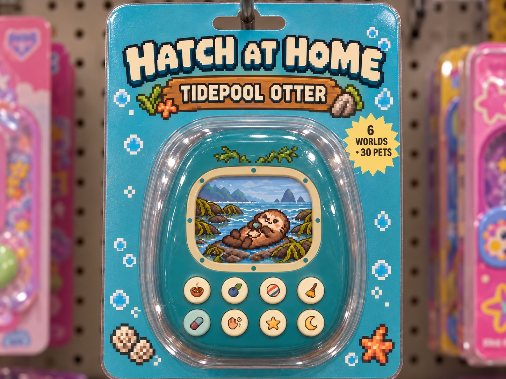 <strong>TIDEPOOL • SEA OTTER</strong> Color LCD</td>
<td width="33%" align="center">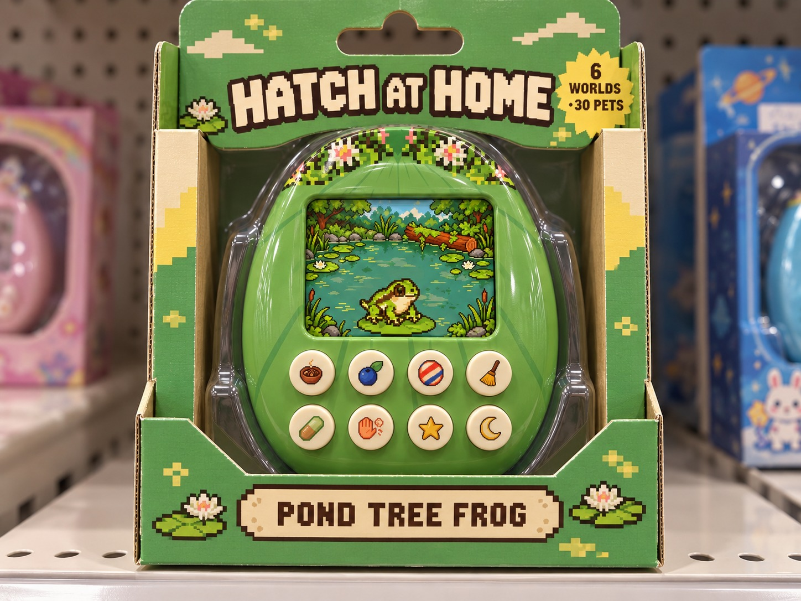 <strong>POND • TREE FROG</strong> Color LCD</td>
<td width="33%" align="center">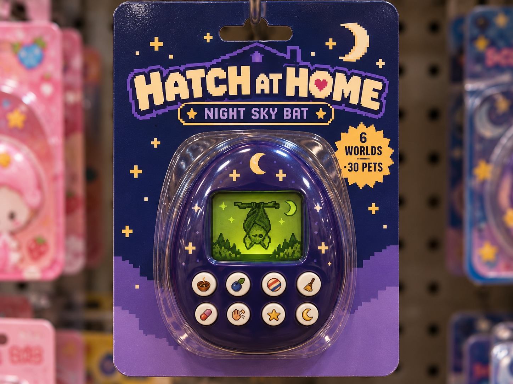 <strong>NIGHT SKY • BAT</strong> Mono + green backlight</td>
</tr>
</table>

Toy-store-style pack shots. The pet itself lives in Home Assistant.

  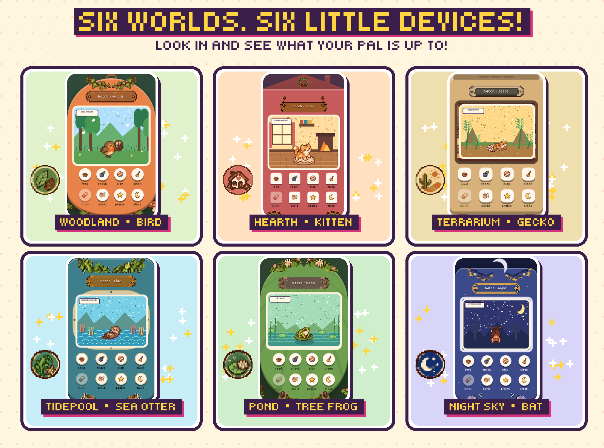

Real in-game shells! Four more pets wait in every world.

## ★ WHAT'S IN THE BOX? ★

  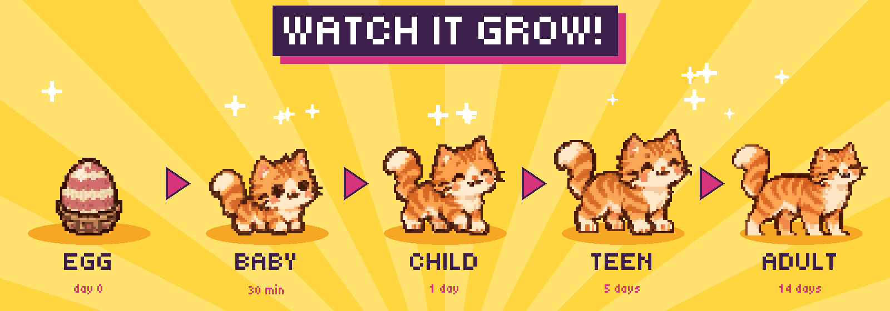

- 🍙 **Care!** Feed, play, clean, tuck in, give a pat
- 📣 **It calls for YOU!** You get 20 minutes to answer
- 🎮 **3 mini-games!** *Left or right?*, *Higher or lower?*, *Berry dig*
- 🌱 **Grows up!** Egg, baby, child, teen, adult
- 🧬 **Own personality!** Traits, tricks, a family that goes on
- 💌 **Wishes, dreams and visitors!** A little news every day
- 💛 **Bonds!** It gets to know each person at home
- 🎃 **Seasons!** Halloween, Thanksgiving and winter lights
- 📱 **Phone alerts!** Optional, with buttons to answer

## 🏠 IT KNOWS YOUR HOUSE!

Connect what you already have in Home Assistant, and your pet may:

| When your home… | Your pet… |
| --- | --- |
| 🌧️ gets rain in the forecast | watches the drops and asks for its blanket |
| 🔥 has a fireplace lit | curls up beside the fire |
| 🌡️ has mapped heating or cooling | can get help with a blanket or fan request |
| 🎵 plays music | dances along |
| 📺 turns on the TV | watches with you |
| 🤖 starts a robot vacuum | watches it go by and says when it starts and goes home |
| 🧺 finishes a washer, dryer or dishwasher cycle | lets you know it's done |
| ✅ ticks off a chore | earns a treat |
| 🌙 reaches bedtime | says good night and goes to sleep |
| 🚪 welcomes you home | gets excited to see you |
| 🔔 rings the doorbell | startles, with two notes and a line |
| 🔌 has anything else you point it at | notices it with the [house moment blueprint](docs/guide.md#let-the-pet-notice-things-house-moment-blueprint) |

Every connection is optional. Away for a while? It waits safely with the sitter.

## 🐣 HOW TO HATCH

**You'll need:** Home Assistant 2026.10+ and [HACS](https://hacs.xyz).
Batteries not required!

1. In HACS, open **⋮ → Custom repositories**, add
   `https://github.com/alpine-vortex/hatch-at-home` as an **Integration**, then
   download **Hatch at Home** and restart Home Assistant.
2. **Settings → Devices & services → Add integration → Hatch at Home.** Name your
   pet and pick a world.
3. Add the **Hatch at Home pet shelf** card to a dashboard. Say hi!

📖 Back up first, add more pets, connect your house: the
[full guide](docs/guide.md) has it all.

  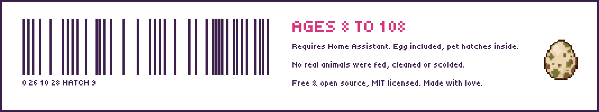

MIT licensed, see [`LICENSE`](LICENSE). The bundled Tiny5 font is under the
SIL Open Font License (`custom_components/virtual_pet/frontend/fonts/OFL.txt`).
